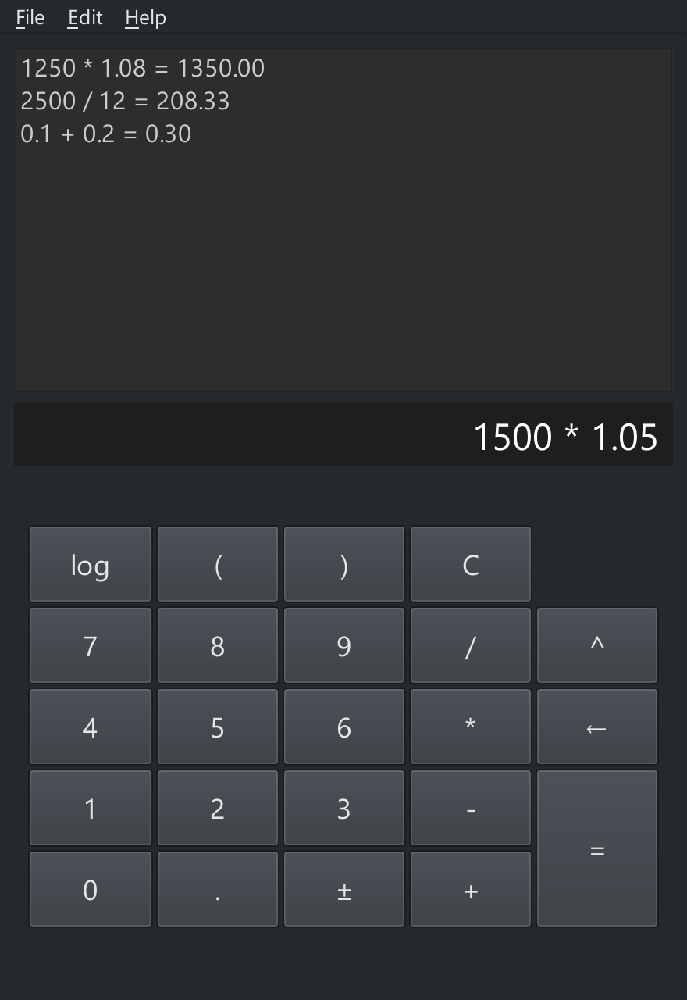

<!-- rumdl-disable MD041 -->
<!-- rumdl-disable MD033 -->

<p align="center">
  
</p>

<h1 align="center">Fin Calc</h1>

<p align="center">
  Decimal arithmetic. Persistent history. Windows, Android, and iOS.
</p>

<p align="center">
  <a href="LICENSE">MIT License</a> ·
  <a href="docs/USER_MANUAL.md">User Manual</a> ·
  <a href="#usage-examples">Getting Started</a>
</p>

<p align="center">
  
  <br>
  <em>Windows graphical calculator with sample history.</em>
</p>

<!-- rumdl-enable MD033 -->

## Short Description

Decimal-precision calculator with graphical, terminal, and command-line
interfaces

## Long Description

Fin Calc is a decimal calculator for Windows, Android, iPhone, and iPad.
Calculate expressions, review past results, and keep a persistent calculation
history. The graphical apps include a keypad, calculation tape, display
settings, and CSV export. Windows also offers terminal and command-line
interfaces.

Licensed under the [MIT License](LICENSE).

## Usage Examples

### Windows

Requires Python 3.12 or newer. Clone or download this repository, then open
PowerShell in the repository folder and install the application:

```powershell
python -m venv platform/windows/.venv
platform/windows/.venv/Scripts/python.exe -m pip install -e ./platform/windows
```

Choose an interface interactively:

```powershell
platform/windows/.venv/Scripts/python.exe -m fin_calc.main
```

Launch directly or run a command:

```powershell
platform/windows/.venv/Scripts/python.exe -m fin_calc.main --gui
platform/windows/.venv/Scripts/python.exe -m fin_calc.main --tui
platform/windows/.venv/Scripts/python.exe -m fin_calc.main --cli
platform/windows/.venv/Scripts/python.exe -m fin_calc.main --cli calculate "0.1 + 0.2"
platform/windows/.venv/Scripts/python.exe -m fin_calc.main history
platform/windows/.venv/Scripts/python.exe -m fin_calc.main --help
```

The installed `platform/windows/.venv/Scripts/fin-calc.exe` command accepts the
same arguments. With the virtual environment activated, you can use `fin-calc`
directly. `--cli` opens a persistent `fin-calc>` prompt: enter expressions
without quotes, `history` to see saved calculations, `help` for usage, and
`exit` or `quit` to leave. Ctrl+C or end of input also exits. Each successful
calculation is saved immediately. One-shot CLI commands also work without
`--cli`. Noninteractive runs must supply a command or interface flag; GUI/TUI
flags cannot accompany commands.

In the TUI, type an expression and press Enter. Escape clears input; Ctrl+Q
quits. The result and saved tape use the configured display precision, while
stored results retain full precision. Settings editing and CSV export remain
available in the GUI. History and settings are saved in the repository's
`data/` folder. See the [user manual](docs/USER_MANUAL.md) for more details.

### Android

Open `platform/android/` in Android Studio, allow Gradle to sync, and run the
**app** configuration on an Android 8.0 or newer device or emulator. Install
Android SDK Platform 37 when prompted. The Android app runs natively in Kotlin
and does not require Python.

See the [Android build guide](platform/android/README.md) for command-line
builds, tests, and release preparation.

### iPhone and iPad

Requires a Mac with Xcode supporting Swift 6, and an iOS 17 or newer simulator
or device. From the repository folder, open the Xcode project:

```bash
open platform/ios/FinCalc.xcodeproj
```

Select the **FinCalc** scheme and a simulator, then choose **Product > Run**.
To run on a physical device, first select your development team in the
FinCalc target's signing settings.

### Example calculations

Example calculations supported by the interface:

```text
0.1 + 0.2 = 0.3
log ( 100 ) = 2
2 ^ 10 = 1024
```

## Source layout

- `platform/windows/fin_calc/` contains the Windows Python package.
- `platform/windows/tests/` contains its tests.
- `platform/ios/` and `platform/android/` contain the native platform projects.

After changing the source layout, reinstall the editable package in an existing
virtual environment before launching it:

```powershell
platform/windows/.venv/Scripts/python.exe -m pip install --no-deps -e ./platform/windows
```

The [Windows development guide](platform/windows/README.md) covers commands run
inside the Windows project. Repository-wide Markdown settings live in
`.rumdl.toml`; Python configuration and the environment live in
`platform/windows/`.
