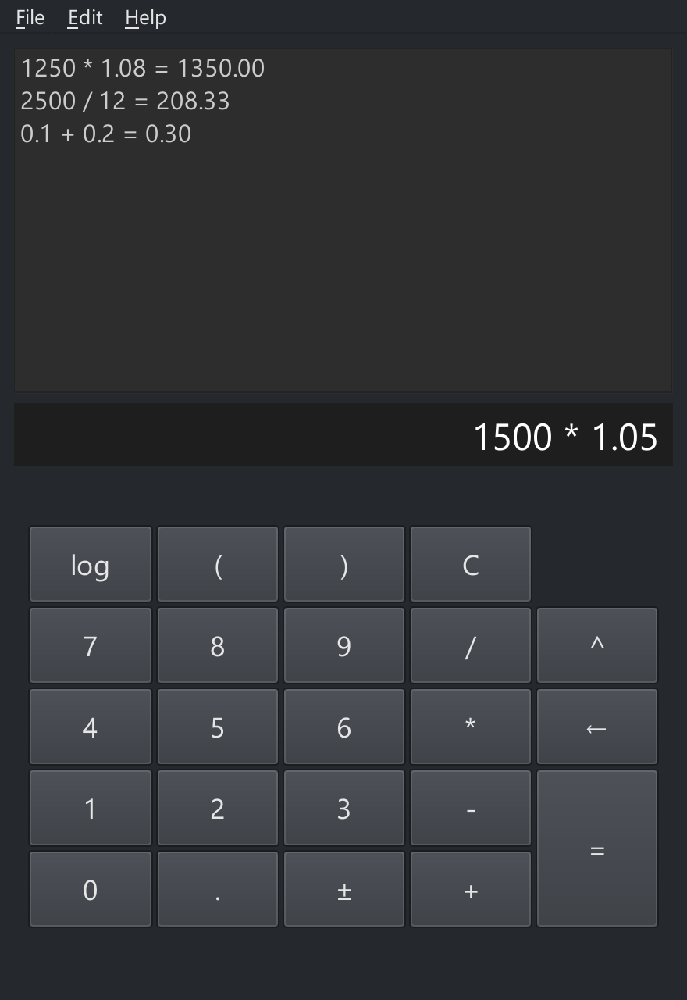
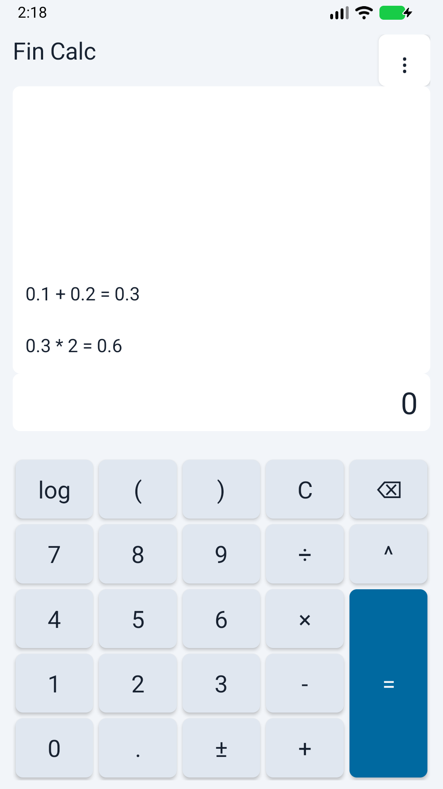

<!-- last_updated: 2026-11-11 -->
<!-- Authoring guidance: dev-docs/specs/README_SPEC.instructions.md -->
<!-- rumdl-disable MD033 MD041 -->

  

<h1 align="center">Fin Calc</h1>

  A decimal calculator for everyday figures and financial calculations, with a saved calculation tape.

  
  
  

  <a href="#download">Download</a> ·
  <a href="docs/USER_MANUAL.md">User manual</a>

<!-- rumdl-enable MD033 MD041 -->

---

## About

Fin Calc helps you check figures, review how you reached a total, and reuse
earlier results without retyping them. It has apps for Windows, Android, iPhone,
and iPad. Your calculation history and settings stay on each device between
sessions; they do not sync across devices.

## Features

- Calculate with decimals, parentheses, powers, and base-10 logarithms. Decimal
  arithmetic gives `0.1 + 0.2 = 0.3`.
- Review saved calculations and reuse their full-precision results in the
  graphical apps.
- Export the calculation tape as CSV from the Windows graphical app and the
  Android and iOS apps.
- Choose light or dark appearance and full precision or 0–6 displayed decimal
  places. Display rounding leaves saved results unchanged.
- Use a graphical window, a terminal interface, or a command-line calculator on
  Windows.
- **Paid subscription · Android · Available on Google Play:** estimate
  enterprise value, equity value, and value per share with the premium DCF
  calculator. Enter cash-flow assumptions, a high-growth period, an optional
  fade to terminal growth, and a discount rate; review the yearly forecast and
  copy the valuation report.

<!-- Android release availability verified against the Google Play listing and release notes on 2026-11-11. -->

## App Screenshot

### Windows GUI

Windows graphical app; the download below is for Android.

### Android

Calculator view from an earlier Android release.

<!-- Add an actual iOS capture when one is available. -->

## Download

| Platform | Download | Notes |
| --- | --- | --- |
| Android | [Google Play](https://play.google.com/store/apps/details?id=com.plaintxtoffice.fincalc) | Free calculator; optional paid DCF subscription. Android 8.0 or newer. |

The Windows build has not been released while signing enrollment is pending. An
iOS release download is not yet provided here.

## User Manual

See the [User Manual](docs/USER_MANUAL.md) for installation, setup, usage, and
troubleshooting.

## License

Fin Calc is proprietary software owned by Plain Text Office LLC. See
[LICENSE](LICENSE) for the terms; all rights reserved.
